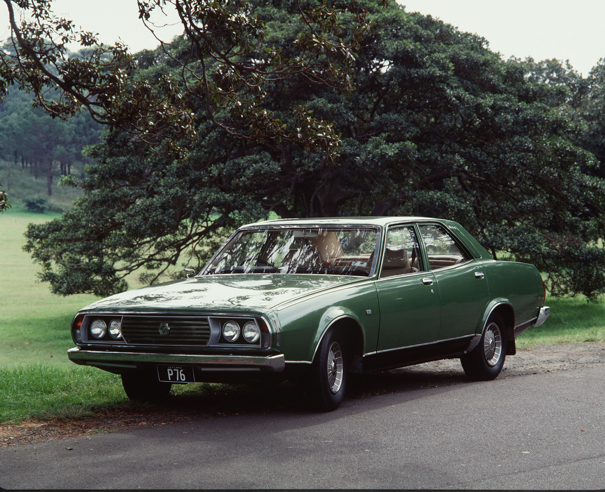

import Gallery from '../../../components/Gallery.astro';

## Предыстория

Жили-были в Великобритании две компании — Morris Motors Limited и Austin Motor Company Limited. Жили неплохо, клепали себе машинки, а в 1952 таки решили объединиться, в результате чего получилась British Motor Corporation — эдакий британский ответ американским корпорациям Большой Тройки. Стали они клепать машинки уже вместе, а попутно ещё и открывать заводы и представительства за пределами страны, в том числе и в Австралии — в 1953 году. Производили там сперва немного доработанные напильником субкомпакты типа Morris Major а в 1961 году к ним присоединились Мини, оказавшиеся очень популярными в Австралии. Однако компании хотелось чего-то большего, а именно — своей доли в стремительно набиравшем популярность сегменте больших семейных автомобилей с рядными шестицилиндровыми двигателями, который к началу 1960-х годов уже был довольно прочно оккупирован моделями «австралийской Большой Тройки» — Ford Fairlane/Holden Special/Chrysler Valiant.

Первой попыткой входа в этот сегмент стал Morris Marshal, производившийся в 1957-1960 гг. и являвшийся бейдж-инжиниринговой версией британского Austin Westminster. После него начались уже более-менее собственные разработки: Austin Freeway и его более престижная версия Wolseley 24/80 (на базе Austin A60), производившиеся в 1962-1965 гг., Austin 1800, причём даже в виде юта (на общей платформе BMC ADO17), производившийся в 1965-1971 гг., а также модифицированный 1800, продававшийся в 1970-1972 гг. как Austin X6 Tasman/Kimberley. Ранние машины строились по привычной австралийскому рынку концепции: рядный 6-цилиндровый двигатель, просторный салон, кузова седан и универсал (чуть позже добавился и ют). Платформа ADO17, выбивалась из общей картины, так как имела передний привод и поперечное расположение двигателя, а в случае с моделью 1800 ещё и 4-цилиндровый двигатель, что было нетипично в этом классе австралийского рынка.

В целом, эти автомобили смогли застолбить себе место на рынке, однако навязать серьёзную борьбу австралийской Большой Тройке пока не получалось. Уже в 1967 году BMC Australia, на основании исследования рынка, пришла к выводу, что слегка перелицованные британские машины продаются не очень хорошо, и пора уже делать что-нибудь своё.

<Gallery images={[
  { src: 'gallery/leyland/p76-1973-1976/11.jpg', alt: 'Morris Marshall', caption: 'Morris Marshall' },
  { src: 'gallery/leyland/p76-1973-1976/12.jpg', alt: 'Morris Marshall', caption: 'Morris Marshall' },
  { src: 'gallery/leyland/p76-1973-1976/13.jpg', alt: 'Austin Freeway', caption: 'Austin Freeway' },
  { src: 'gallery/leyland/p76-1973-1976/14.jpg', alt: 'Austin Freeway', caption: 'Austin Freeway' },
  { src: 'gallery/leyland/p76-1973-1976/15.jpg', alt: 'Wolseley 24/80', caption: 'Wolseley 24/80' },
  { src: 'gallery/leyland/p76-1973-1976/16.jpg', alt: 'Austin 1800 Ute', caption: 'Austin 1800 Ute' },
  { src: 'gallery/leyland/p76-1973-1976/17.jpg', alt: 'Austin 1800 Ute', caption: 'Austin 1800 Ute' },
  { src: 'gallery/leyland/p76-1973-1976/18.jpg', alt: 'Austin X6 Tasman', caption: 'Austin X6 Tasman' },
  { src: 'gallery/leyland/p76-1973-1976/19.jpg', alt: 'Austin X6 Tasman', caption: 'Austin X6 Tasman' },
  { src: 'gallery/leyland/p76-1973-1976/20.jpg', alt: 'Austin X6 Kimberley', caption: 'Austin X6 Kimberley' },
]} />

Изначально предлагалось два направления развития. Первым должен был стать мид-сайз, наследник линейки X6 Tasman/Kimberley, а вторым — принципиально новый семейный заднеприводный фулл-сайз. Мид-сайз, условно названный Model A, должен был появиться в 1973 году, фулл-сайз Model B — в 1974 году. С этой программой делегация BMC Australia в 1968 году была готова отправиться в Лондон, чтобы добиться поддержки и финансирования в штаб-квартире BMC. Однако именно в это время в дело вмешались непредвиденные факторы.

Чтобы понять суть проблемы, нужно сделать небольшое лирическое отступление и посмотреть на тогдашнюю ситуацию в Великобритании в исторической перспективе. После Второй Мировой страна пребывала в состоянии вяло текущего экономического кризиса с периодическими проблесками оптимизма и экономического роста, и основные политические силы страны — партии консерваторов и лейбористов — разумеется, имели своё мнение по вопросу «Как нам обустроить Великобританию». Подчас диаметрально противоположное. Применительно к экономике это означало, что консерваторы были сторонниками свободного, саморегулирующегося рынка и невмешательства государства в экономику, а лейбористы, напротив, выступали за государственное регулирование экономики, планирование и прочие прелести Кейнсианской модели. На практике это приводило к тому, что после каждой смены большинства в парламенте новая правящая партия принималась с энтузиазмом переделывать на свой лад всё то, что было сделано предшественником, причём не всегда с хорошим результатом. Смены правящей партии, конечно, происходили не настолько часто, чтобы это можно было назвать чехардой, но весьма метко, и одна из них произошла как раз перед описываемыми нами событиями. В 1964 году большинство в парламенте получили лейбористы, правительство возглавил Гарольд Уилсон. На повестке дня был очередной виток экономического кризиса, вопрос о девальвации фунта и много других, не слишком приятных вещей. Лейбористы взялись за дело в свойственной им манере, с широким государственным регулированием, а одним из методов оздоровления экономики было провозглашено слияние и укрупнение существовавших в Великобритании компаний. Под эту волну попало много британских компаний, в том числе British Motor Corporation и Leyland Motor Corporation, которые в 1968 году были добровольно-принудительно объединены в компанию British Leyland Motor Corporation. После этих преобразований в Австралии было создано новое отделение - British Leyland Motor Corporation of Australia, в 1972 году переименованное в Leyland Motor Corporation of Australia.

Таким образом, делегация BMC Australia (теперь уже BLMC Australia), отправляясь в Лондон выбивать финансирование для своего нового проекта, фактически ехала к новому совету директоров, и договариваться ей нужно было с совершенно незнакомыми людьми, гораздо более озабоченными проблемами автозаводов внутри Великобритании, чем тем, что происходило на другом конце света. В то же время в Великобритании полным ходом шла работа над проектом ADO28, который дал начало автомобилю Morris Marina. Когда австралийскую делегацию ознакомили с уже имевшимися наработками по ADO28, они решили, что по основным параметрам проект удовлетворяет требованиям к мид-сайзу Model A. Даже несмотря на очевидную устаревшесть конструкции, многие узлы которой вели свою историю ещё от Morris Minor, было решено запустить машину в производство в Австралии с рядной шестёркой (в Великобритании автомобиль комплектовался 4-цилиндровыми двигателями) под названием Leyland Marina, что и было сделано в 1971 году. Оставался только проект фулл-сайза Model B, и вот его-то австралийцам предстояло делать самостоятельно.

<Gallery images={[
  { src: 'gallery/leyland/p76-1973-1976/21.jpg', alt: '1973 Leyland Marina Deluxe Sedan', caption: '1973 Leyland Marina Deluxe Sedan' },
  { src: 'gallery/leyland/p76-1973-1976/22.jpg', alt: '1973 Leyland Marina Deluxe Sedan', caption: '1973 Leyland Marina Deluxe Sedan' },
  { src: 'gallery/leyland/p76-1973-1976/23.jpg', alt: '1973 Leyland Marina Deluxe Sedan', caption: '1973 Leyland Marina Deluxe Sedan' },
  { src: 'gallery/leyland/p76-1973-1976/24.jpg', alt: '1973 Leyland Marina Deluxe Sedan', caption: '1973 Leyland Marina Deluxe Sedan' },
  { src: 'gallery/leyland/p76-1973-1976/25.jpg', alt: '1973 Leyland Marina Deluxe Sedan', caption: '1973 Leyland Marina Deluxe Sedan' },
  { src: 'gallery/leyland/p76-1973-1976/26.jpg', alt: '1973 Leyland Marina Deluxe Sedan', caption: '1973 Leyland Marina Deluxe Sedan' },
  { src: 'gallery/leyland/p76-1973-1976/27.jpg', alt: '1973 Leyland Marina Deluxe Sedan', caption: '1973 Leyland Marina Deluxe Sedan' },
  { src: 'gallery/leyland/p76-1973-1976/28.jpg', alt: '1973 Leyland Marina Deluxe Sedan', caption: '1973 Leyland Marina Deluxe Sedan' },
  { src: 'gallery/leyland/p76-1973-1976/29.jpg', alt: '1973 Leyland Marina Deluxe Sedan', caption: '1973 Leyland Marina Deluxe Sedan' },
  { src: 'gallery/leyland/p76-1973-1976/30.jpg', alt: '1973 Leyland Marina Deluxe Sedan', caption: '1973 Leyland Marina Deluxe Sedan' },
]} />

## Разработка

Разумеется, разработка новой модели с нуля — дело долгое и дорогое. Конечно, в Лейланде планировали использовать по максимуму уже имеющиеся узлы и механизмы, но кузов всё равно нужно было делать с нуля. Директор инженерного отдела BLMC Australia Дэвид Бич просил у руководства на разработку сумму 30 миллионов австралийских долларов, но ему выделили только 21 миллион, что значительно ограничивало возможности проектирования. Да и, к тому же, у BLMC Australia не было ни собственного испытательного полигона, ни даже собственной дизайн-студии. Дизайнеры сидели в уголке Экспериментального отдела и тихо что-то там рисовали — в основном дорабатывали напильником спущенные из Великобритании дизайны, рисовать своё с нуля им никто не доверял. Так что машину предстояло собирать в прямом смысле с миру по нитке. В итоге Лейланду такой подход очень сильно вышел боком, но на стадии разработки всё казалось сравнительно безоблачным, руководство было полно оптимизма и всё такое прочее.

Разработка и обкатка технических решений для шасси проходила, в основном, в Австралии. Вопрос с компоновкой был решён, в общем-то, ещё до поездки к руководству в Великобританию: попытка поставить V8 поперечно на переднеприводную платформу ADO17 произвела на свет по-своему интересную машину, но с отвратительной управляемостью, поэтому выбор был сделан в пользу классического заднего привода. Двигатели было решено взять с уже имеющихся машин: рядную шестёрку Е-серии, которая уже была знакома австралийцам по платформе ADO17, а также V8 от Rover SD1, в ходе тестов — доработать их. Так закладывались технические основы проекта YDO26, будущего Leyland P76.

А теперь интересный факт. Мы же помним, что BLMC Australia не располагала тестовым полигоном от слова совсем? Так вот, машины приходилось тестировать на дорогах общего пользования. А чтобы не палить раньше времени новинки (а в случае с YDO26 палить было нечего в принципе, так как кузова ещё не было в природе), инженеры пошли на хитрость: они закупили три Холдена HK (седан, универсал и купе) и установили в них свои компоненты в различных конфигурациях: рядную шестёрку, расточенную до 2,6 литра, 3,5-литровый V8 от Ровера, усилитель руля, подвеску МакФерсон, АКПП BorgWarner 35 и т.д. В таком виде и обкатывались все технические решения — причём эксперимент оказался настолько удачным, что позже было приобретено ещё 4 Холдена и доработано для тестов. Финальный тестовый образец был собран уже в 1971 году.

Пока инженеры прокачивали навык «Маскировка», Дэвид Бич мотался по миру, пытаясь найти место, где ему нарисуют, а потом и изготовят кузов для YDO26. Мы же помним, что отдел дизайна в BLMC Australia существовал только номинально, и полностью своих дизайнов ему не доверяли? Вот и поехал Бич в турне по кузовным ателье. Изначально планировалось работать с Италдизайном, но Бич и Джуджаро маленько не сошлись характерами и сотрудничества не получилось. После этого Бич скатался ещё в Карманн и Мичелотти, что получилось более успешно — обе фирмы представили своё видение кузова YDO26. Также свой проект представила дизайн-студия BMC в Лонгбридже. Но тут в дело вмешался всеми забытый австралийский отдел дизайна. Его руководитель Романд Родберг был далеко не в восторге от того, что с ним даже никто не посоветовался по проекту YDO26, поэтому нарисовал своё собственное видение автомобиля и тоже отослал эскизы на презентацию в головной офис BMC. И что самое удивительное — именно его эскизы привлекли наибольшее внимание на презентации и были в итоге одобрены. Но идею с дизайном от именитого ателье так просто не забыли — уж очень хотелось Лейланду щегольнуть и прилепить на машины шильдик типа «Design by \*\*\*» — такого не делал никто из австралийской Большой Тройки. Поэтому дизайн Родберга был одобрен, но передан Мичелотти (с которым на тот момент постоянно работал головной офис BMC) на косметическую доработку. Это решение оказалось компромиссным и вроде бы удовлетворило все стороны.

По другой версии, дизайн всё-таки был от Мичелотти, но переделанный на усмотрение Лейланда, а именно — вездесущего Дэвида Бича, который 3 месяца околачивался в студии, «руководя проектом». В итоге он всем так надоел, что, после очередной жалобы на дизайн передней части, Мичелотти дал ему карандаш со словами: «Рисуй сам». Схожая ситуация получилась и с задней частью — Мичелотти нарисовал довольно элегантную и приземистую заднюю часть, но в Лейланде хотели «Самый Большой Багажник в Классе», поэтому поверх эскиза Мичелотти просто была нарисована новая линия, которая и обозначила задранную, широкую заднюю часть серийного P76.

Другим вопросом оставалось производство кузовных панелей. Изначально Бич надеялся, что оборудование для сборочной линии сможет сделать Карманн — была даже достигнута устная договорённость — но немцы не укладывались в сроки подготовки проекта, а откладывать его никто не хотел. В итоге заказ был передан дочерней фирме BMC — Pressed Steel-Fisher. Был тут, правда, один нюанс: кузовные панели для YDO26 оказались самыми большими во всей линейке компании, оборудование требовалось соответствующее, а вот сможет ли Pressed Steel-Fisher обеспечить достаточное качество этого самого оборудования? Но этот вопрос оказался благополучно проигнорирован (что, кстати, тоже потом аукнулось Лейланду). У Pressed Steel-Fisher были свободные производственные мощности и располагались они в том же Лонгбридже, так что можно было не сдвигать сроки подготовки производства, и это оказалось решающим фактором.

<Gallery images={[
  { src: 'gallery/leyland/p76-1973-1976/31.jpg', alt: 'Leyland P76 pre-series', caption: '' },
  { src: 'gallery/leyland/p76-1973-1976/32.jpg', alt: 'Leyland P76 assembly line', caption: 'Кузова P76 на сборочной линии' },
  { src: 'gallery/leyland/p76-1973-1976/33.jpg', alt: 'Leyland P76 pre-series', caption: '' },
  { src: 'gallery/leyland/p76-1973-1976/34.jpg', alt: 'Leyland P76 pre-series interior', caption: '' },
  { src: 'gallery/leyland/p76-1973-1976/35.jpg', alt: 'Leyland P76 pre-series trunk', caption: '' },
  { src: 'gallery/leyland/p76-1973-1976/36.jpg', alt: 'Leyland P76 pre-series interior', caption: '' },
  { src: 'gallery/leyland/p76-1973-1976/37.jpg', alt: 'Leyland P76 pre-series', caption: '' },
]} />

## Серийный автомобиль

Так или иначе, к 1973 году все части пазла были собраны воедино, прототипы с серийными кузовами были обкатаны на британских полигонах BMC, оборудование отправлено в Австралию, производство машин налажено и даже проведена соответствующая рекламная кампания. И вот, P76 наконец-то пошёл в серию.

Автомобиль обладал рядом прогрессивных по меркам австралийского рынка конструкторских решений: лёгкий алюминиевый V8, передняя подвеска типа МакФерсон, реечное рулевое управление , усилитель руля и тормозов, открывающийся против движения капот, вклееное лобовое стекло, скрытые дворники, а в дверях были интегрированы дополнительные силовые элементы на случай бокового удара — впервые в австралийской машине (их применение стало обязательным в Австралии только в 1976 году). К тому же автомобиль имел очень просторный салон и действительно большой багажник (пресловутый пример про идеально входящую в багажник бочку объёмом 44 галлона), а также высокую ремонтопригодность и был прост в обслуживании. Это было следствием одного из постулатов Дэвида Бича, которых он придерживался при работе над машиной: механикам должно быть легко её обслуживать. Соответственно, инженеры постарались максимально облегчить доступ к основным узлам машины и добиться по возможности более высокой степень взаимозаменяемости деталей с другими моделями марки. Ещё одной особенностью были передаточные числа трансмиссии. Так как на большинстве австралийских дорог в то время скорость была ограничена 70 милями в час, было решено сместить акцент не в сторону скорости, а в сторону максимального крутящего момента на низких оборотах. Именно поэтому P76 получился не очень быстрым, но, по свидетельствам владельцев, мог утащить за собой хоть небольшой дом.

Автомобиль предлагался только в одном кузове — 4-дверный седан — и в трёх комплектациях: Deluxe, Super и Executive. В базе автомобиль оснащался рядной 2,6-литровой шестёркой Е-серии, которая выдавала 121 л.с. и 224 Нм., и механической коробкой. В качестве опции на комплектациях Deluxe и Super был доступен алюминиевый 4,4-литровый V8, который выдавал уже 192 л.с. и 386 Нм, а на комплектации Super — ещё и АКПП. Executive был доступен только в одном сочетании — V8 + АКПП.

Внешне базовая комплектация Deluxe выделялась из линейки одинарными 7-дюймовыми передними фарами и минимумом хромированного трима, в салоне — отсутствием ковриков, деревянных вставок на панели и обивки на верхних частях дверей, а также минимумом шумоизоляции. Чуть позже для неё был предложен т.н. Luxury Pack, состоявший из раздельных ковшеобразных сидений, радио и ковриков.

Комплектация Super отличалась двойными 5,5-дюймовыми передними фарами и решёткой, аналогичными применявшейся на топовой комплектации Executive, а также большим количеством хромированного трима на кузове. В салоне были только раздельные сиденья (цельного переднего дивана, как в базовой Deluxe, не было даже в виде опции), ковры, полная обивка дверей, а также деревянные вставки на дверях и передней панели. Сама передняя панель, с часами и вольтметром, также была идентична панели из версии Executive.

Топовая комплектация Executive, как уже было сказано, комплектовалась исключительно V8 в сочетании с АКПП. Внешне она отличалась от версии Super резиновой полосой на бамперах и красной окантовкой шильдика на решётке радиатора. Практически все доступные опции уже были включены в начальную стоимость машины — в списке опций остался только кондиционер, дополнительное салонное освещение, лампа оповещения о незакрытой двери (кстати, тоже впервые в австралийской машине) и ещё кое-какие мелочи.

<Gallery images={[
  { src: 'gallery/leyland/p76-1973-1976/41.jpg', alt: '1973 Leyland P76 brochure', caption: '' },
  { src: 'gallery/leyland/p76-1973-1976/42.jpg', alt: '1973 Leyland P76 brochure', caption: '' },
  { src: 'gallery/leyland/p76-1973-1976/43.jpg', alt: '1973 Leyland P76 brochure', caption: '' },
  { src: 'gallery/leyland/p76-1973-1976/44.jpg', alt: '1973 Leyland P76 brochure', caption: '' },
  { src: 'gallery/leyland/p76-1973-1976/45.jpg', alt: '1973 Leyland P76 brochure', caption: '' },
  { src: 'gallery/leyland/p76-1973-1976/46.jpg', alt: '1973 Leyland P76 brochure', caption: '' },
]} />

В 1974 году Leyland P76 в практически заводской спецификации принёс победу на ралли Тарга Флорио австралийским гонщикам Эвану Грину и Джону Брайсону. Чтобы отпраздновать эту победу, Лейланд выпустил ограниченную серию P76 Targa Florio. Автомобиль собирался на основе заводского P76 Super с V8 и АКПП и отличался от него наличием дифференциала повышенного трения, спортивными дисками, эксклюзивными цветами кузова и полосами на боковинах.

<Gallery images={[
  { src: 'gallery/leyland/p76-1973-1976/51.jpg', alt: '1974 Leyland P76 Targa Florio', caption: '1974 Leyland P76 Targa Florio' },
  { src: 'gallery/leyland/p76-1973-1976/52.jpg', alt: '1973 Leyland P76 Targa Florio', caption: '1974 Leyland P76 Targa Florio' },
  { src: 'gallery/leyland/p76-1973-1976/53.jpg', alt: '1973 Leyland P76 Targa Florio', caption: '1974 Leyland P76 Targa Florio' },
  { src: 'gallery/leyland/p76-1973-1976/54.jpg', alt: '1973 Leyland P76 Targa Florio', caption: '1974 Leyland P76 Targa Florio' },
  { src: 'gallery/leyland/p76-1973-1976/55.jpg', alt: '1973 Leyland P76 Targa Florio', caption: '1974 Leyland P76 Targa Florio' },
  { src: 'gallery/leyland/p76-1973-1976/56.jpg', alt: '1973 Leyland P76 Targa Florio', caption: '1974 Leyland P76 Targa Florio' },
  { src: 'gallery/leyland/p76-1973-1976/57.jpg', alt: '1973 Leyland P76 Targa Florio', caption: '1974 Leyland P76 Targa Florio' },
  { src: 'gallery/leyland/p76-1973-1976/58.jpg', alt: '1973 Leyland P76 Targa Florio', caption: '1974 Leyland P76 Targa Florio' },
  { src: 'gallery/leyland/p76-1973-1976/59.jpg', alt: '1973 Leyland P76 Targa Florio', caption: '1974 Leyland P76 Targa Florio' },
  { src: 'gallery/leyland/p76-1973-1976/60.jpg', alt: '1973 Leyland P76 Targa Florio', caption: '1974 Leyland P76 Targa Florio' },
]} />

Грамотная пиар-кампания Лейланда принесла свои плоды. P76 был, пожалуй, самым ожидаемым автомобилем 1973 года. Публика чуть ли не штурмом брала шоу-румы, за машиной выстраивались очереди на несколько месяцев, а Лейланд не успевал производить достаточно машин, чтобы удовлетворить спрос. Правда, уже через несколько месяцев стали сыпаться жалобы на плохое качество сборки и прочие детские болезни, а дилеры оказались завалены машинами с гарантийными поломками. Лейланд, однако, не терял оптимизма, старался устранять недоделки по гарантии да и вообще работал над развитием линейки. Имидж модели, конечно, эти косяки подпортили, и покупательский энтузиазм несколько остыл, но это не помешало P76 получить премию «Автомобиль года» по версии журнала Wheels. Но бесконечно это продолжаться не могло, особенно в условиях топливного кризиса 1973 года, который значительно уменьшил спрос на фулл-сайзы. В итоге в октябре 1974 года был закрыт завод в Зетлэнде, производивший P76, вместе с ним было закрыто и австралийское производство модели.

<Gallery images={[
  { src: 'gallery/leyland/p76-1973-1976/61.jpg', alt: 'The last australian Leyland P76 rolls of the assembly line', caption: 'Последний австралийский Leyland P76 сходит со сборочной линии' },
  { src: 'gallery/leyland/p76-1973-1976/62.jpg', alt: 'The last Leyland P76', caption: 'Последний австралийский Leyland P76' },
  { src: 'gallery/leyland/p76-1973-1976/63.jpg', alt: 'The last Leyland P76', caption: 'Последний австралийский Leyland P76' },
]} />

Машинокомплекты, однако, продолжали ещё какое-то время поставляться в Новую Зеландию. Там P76 местной сборки (только с V8) вполне хорошо продавались до августа 1976 года.

<Gallery images={[
  { src: 'gallery/leyland/p76-1973-1976/64.jpg', alt: 'Leyland P76 in New Zealand rally events', caption: 'В Новой Зеландии Leyland P76 пользуется большой популярностью в ралли' },
  { src: 'gallery/leyland/p76-1973-1976/65.jpg', alt: 'Leyland P76 in New Zealand rally events', caption: 'В Новой Зеландии Leyland P76 пользуется большой популярностью в ралли' },
  { src: 'gallery/leyland/p76-1973-1976/66.jpg', alt: 'Leyland P76 in New Zealand rally events', caption: 'В Новой Зеландии Leyland P76 пользуется большой популярностью в ралли' },
  { src: 'gallery/leyland/p76-1973-1976/67.jpg', alt: 'Leyland P76 in New Zealand rally events', caption: 'В Новой Зеландии Leyland P76 пользуется большой популярностью в ралли' },
]} />

## Прототипы и собственные разработки

У Лейланда были большие планы на австралийский рынок, и седан P76 должен был стать лишь первым из серии различных моделей собственной разработки. Так, например, уже на момент его запуска в производство активно велись работы по созданию универсала на его платформе, который планировалось запустить в серию через некоторое время после седана. Универсал имел практически аналогичный седану дизайн, за исключением того, что задняя стойка была сделана менее наклонной, чтобы облегчить посадку-высадку задних пассажиров. Однако к 1974 году работа над программой универсалов была свёрнута в пользу другого, более интересного и перспективного проекта — купе Force 7. Всего было произведено 3 тестовых прототипа универсала и один пластиковый макет, но 2 прототипа были разбиты во время тестов, и до наших дней сохранился только один универсал.

<Gallery images={[
  { src: 'gallery/leyland/p76-1973-1976/71.jpg', alt: 'Leyland P76 Station Wagon Prototype', caption: '' },
  { src: 'gallery/leyland/p76-1973-1976/72.jpg', alt: 'Leyland P76 Station Wagon Prototype', caption: '' },
  { src: 'gallery/leyland/p76-1973-1976/73.jpg', alt: 'Leyland P76 Station Wagon Prototype', caption: '' },
  { src: 'gallery/leyland/p76-1973-1976/74.jpg', alt: 'Leyland P76 Station Wagon Prototype', caption: '' },
  { src: 'gallery/leyland/p76-1973-1976/75.jpg', alt: 'Leyland P76 Station Wagon Prototype', caption: '' },
  { src: 'gallery/leyland/p76-1973-1976/76.jpg', alt: 'Leyland P76 Station Wagon Prototype, the only one left in existence', caption: 'Единственный сохранившийся прототип Leyland P76 Station Wagon' },
  { src: 'gallery/leyland/p76-1973-1976/77.jpg', alt: 'Leyland P76 Station Wagon Prototype, the only one left in existence', caption: 'Единственный сохранившийся прототип Leyland P76 Station Wagon' },
  { src: 'gallery/leyland/p76-1973-1976/78.jpg', alt: 'Leyland P76 Station Wagon Prototype, the only one left in existence', caption: 'Единственный сохранившийся прототип Leyland P76 Station Wagon' },
  { src: 'gallery/leyland/p76-1973-1976/79.jpg', alt: 'Leyland P76 Station Wagon Prototype, the only one left in existence', caption: 'Единственный сохранившийся прототип Leyland P76 Station Wagon' },
]} />

Пришедший на смену проекту универсала купе-хэтчбэк Force 7 был по-своему уникальным. Это был первый серийный австралийский хэтчбэк, появившийся за несколько лет до Holden LX Torana. К тому же, это был долгожданный 2-дверный вариант, который мог значительно расширить аудиторию покупателей P76 — ведь у основных его конкурентов в линейке постоянно были 2-дверные модификации. Поэтому неудивительно, что Лейланд в итоге сделал выбор в пользу развития проекта Force 7. Что интересно, в отличие от седана и универсала, дизайн купе был практически полностью взят из эскиза Мичелотти — что, в общем, заметно по внешнему виду автомобиля, сильно отличающемуся от стандартных P76. Как результат, седан и купе практически не имели общих кузовных панелей, что стало одним из решающих факторов, когда дело дошло до запуска машины в серию.

Лейланд планировал делать купе в трёх версиях: базовая Force 7, средняя Force 7V (примерно аналогичная комплектации Super), и топовая Tour de Force, условно соответствующая седановской Executive. Предполагалось, что машины будут оснащаться теми же двигателями, что и седаны, но и про спортивную составляющую не забыли: ходили настойчивые слухи, что планировалось сделать двигатель объёмом около 5 литров специально для установки в купе Force 7.

Так или иначе, за проект взялись с энтузиазмом, и к моменту закрытия предприятия уже существовало 56 предсерийных машин в разной степени готовности, причём один из прототипов уже был отправлен в Великобританию, для тестов в штаб-квартире BLMC. Однако после закрытия заводов австралийского Лейланда эти машины внезапно стали никому не нужны. Дальнейшие же события являются предметом множества теорий и слухов: руководство распорядилось уничтожить большую часть построенных купе Force 7, оставив только 10 штук (с учётом раннего прототипа, уехавшего в Великобританию). В итоге оставшиеся в живых 9 машин были достроены до комплектации Force 7V, одну из них оставила себе фирма Leyland Australia, а остальные 8 были проданы на аукционе. Ранний экземпляр, уехавший в Англию, отличается от всех остальных эксклюзивной передней панелью со вставками из полированного металла, предназначавшейся именно для Force 7 (в поздних была стандартная панель от седана), окраской в синий металлик и отсутствием тахометра (хотя и не на всех поздних прототипах он был).

<Gallery images={[
  { src: 'gallery/leyland/p76-1973-1976/81.jpg', alt: 'Leyland P76 Force 7', caption: 'Leyland P76 Force 7' },
  { src: 'gallery/leyland/p76-1973-1976/82.jpg', alt: 'Leyland P76 Force 7', caption: 'Leyland P76 Force 7' },
  { src: 'gallery/leyland/p76-1973-1976/83.jpg', alt: 'Leyland P76 Force 7', caption: 'Leyland P76 Force 7' },
  { src: 'gallery/leyland/p76-1973-1976/84.jpg', alt: 'Leyland P76 Force 7', caption: 'Leyland P76 Force 7' },
  { src: 'gallery/leyland/p76-1973-1976/85.jpg', alt: 'Leyland P76 Force 7', caption: 'Leyland P76 Force 7' },
  { src: 'gallery/leyland/p76-1973-1976/86.jpg', alt: 'Leyland P76 Force 7', caption: 'Leyland P76 Force 7' },
  { src: 'gallery/leyland/p76-1973-1976/87.jpg', alt: 'Leyland P76 Force 7', caption: 'Leyland P76 Force 7' },
  { src: 'gallery/leyland/p76-1973-1976/88.jpg', alt: 'Leyland P76 Force 7', caption: 'Leyland P76 Force 7' },
  { src: 'gallery/leyland/p76-1973-1976/89.jpg', alt: 'Leyland P76 Force 7', caption: 'Leyland P76 Force 7' },
  { src: 'gallery/leyland/p76-1973-1976/90.jpg', alt: 'Leyland P76 Force 7', caption: 'Leyland P76 Force 7' },
]} />

Кроме, собственно, расширения линейки P76 Лейланд занимался и другими проектами. Так, например, велись разработки новых двигателей, в частности — V6. Двигатель этот предполагалось делать путём укорачивания существовавшего V8 на 2 цилиндра. В разные периоды тестировались варианты объёмом 2,6 и 3,3 л., сделанные на базе 3,6-литрового V8 от Ровера и 4,4-литрового V8 от P76. С другой стороны, были возможности и для увеличения объёма. Сам Дэвид Бич позже вспоминал, что при конструировании 4,4-литрового двигателя инженеры оставили конструктивный запас для расточки мотора до 5 литров (что косвенно подтверждает слухи о возможности установки 5-литрового мотора в топовые версии Force 7). Осуществление этой моторной программы позволило бы Лейланду, со сравнительно небольшими затратами, полностью покрыть потребности рынка Австралии, предложив рядные шестёрки, V6 и V8 объёмом от 2,6 до 5 литров.

Параллельно с программой P76 Лейланд развивал и ещё один проект, а именно — более компактного собрата P76 под названием P82. Предполагалось, что этот автомобиль заменит Leyland Marina британской разработки и станет основным продуктом компании для австралийского рынка. При разработке конструкторы пошли по тому же пути, что и с P76 — максимально возможное использование деталей от других машин компании для удешевления производства и упрощения обслуживания. Дизайн, кстати, тоже собирали «с миру по нитке», поэтому так до сих пор толком и не ясно, чьему перу принадлежал итоговый облик машин (как и с P76, собственно). При проектировании машины конструкторы старались сохранить вместимость и простор салона, как в P76, совместив это с меньшими внешними размерами.
Автомобиль предполагалось выпускать в широкой гамме версий: 3-дверный хэтчбэк, 4-дверные седаны с разными вариантами оформления передней части, 2-дверное купе и даже фургон. Хэтчам и купе полагалась короткая колёсная база, седанам и фургону — длинная. Под капотом могла быть рядная 1,8-литровая четвёрка или рядная же 2,6-литровая шестёрка (оба из E-серии), а также разрабатывавшийся в то время на базе V8 от P76 3,3-литровый V6. Циркулировали также слухи о возможности установки V8 от P76 в топовые версии купе, что превратило бы его в реального конкурента Holden Torana SL/R. Но увы, вместе с закрытием производства в октябре 1974 года были свёрнуты и все экспериментальные проекты. К тому времени уже были готовы несколько масштабных макетов и один ходовой прототип с двигателем V6, который был вывезен в Англию и даже демонстрировался в руководству в Лонгбридже, которое, правда, было не сильно в нём заинтересовано. После этого след машины теряется, сохранилась ли она до наших дней — неизвестно.

<Gallery images={[
  { src: 'gallery/leyland/p76-1973-1976/91.png', alt: 'Leyland P82 Coupe design proposal', caption: 'Проект дизайна купе Leyland P82' },
  { src: 'gallery/leyland/p76-1973-1976/92.png', alt: 'Leyland P82 Coupe design proposal', caption: 'Проект дизайна купе Leyland P82' },
  { src: 'gallery/leyland/p76-1973-1976/93.jpg', alt: 'Leyland P82 Sedan design proposal', caption: 'Проект дизайна седана Leyland P82' },
  { src: 'gallery/leyland/p76-1973-1976/93-2.jpg', alt: 'Leyland P82 Compact design proposal', caption: 'Проект дизайна хэтчбека Leyland P82' },
  { src: 'gallery/leyland/p76-1973-1976/94.jpg', alt: 'Leyland P82 Sedan clay model by Cassarchis', caption: 'Глиняный макет седана P82, дизайн Марка Кэсаркиса' },
  { src: 'gallery/leyland/p76-1973-1976/95.jpg', alt: 'Leyland P82 Compact clay model by Cassarchis', caption: 'Глиняный макет хэтчбека P82, дизайн Марка Кэсаркиса' },
  { src: 'gallery/leyland/p76-1973-1976/96.jpg', alt: 'Leyland P82 De Luxe Sedan quarter scale clay model by Cassarchis', caption: 'Глиняный макет седана Leyland P82 De Luxe в масштабе 1:4, дизайн Марка Кэсаркиса' },
  { src: 'gallery/leyland/p76-1973-1976/97.jpg', alt: 'Short wheelbase Leyland P82 Coupe proposal by Cassarchis', caption: 'Макет двухдверного купе Leyland P82 на укороченной колесной базе, дизайн Марка Кэсаркиса' },
  { src: 'gallery/leyland/p76-1973-1976/98.jpg', alt: 'Leyland P82 Sedan proposals by Cassarchis (in-house) and Michelotti', caption: 'Два прототипа седана Leyland P82. Слева — собственный дизайн Leyland за авторством Марка Кэсаркиса, справа — дизайн Джованни Мичелотти' },
  { src: 'gallery/leyland/p76-1973-1976/99.jpg', alt: 'Leyland P82 Hatchback by Michelotti', caption: 'Макет хэтчбека Leyland P82 за авторством Джованни Мичелотти, масштаб 1:4' },
  { src: 'gallery/leyland/p76-1973-1976/100.jpg', alt: 'Michelotti\'s P82 sedan front ends comparison', caption: 'Два варианта дизайна передней части седана P82 от Мичелотти. Слева — базовая версия De Luxe, справа — топовая Super' },
]} />

## Что же пошло не так?

Так что же, всё-таки, пошло не так с P76? Ведь задумка-то была хорошая, да и публика изначально была настроена оптимистично…

Да практически всё пошло не так, причём с самого начала. Такое ощущение, что P76 задумывался «под несчастливой звездой» — настолько много негативных факторов сложилось воедино в этом автомобиле. Но давайте попробуем разобраться.

Пожалуй, в самой основе этой истории лежало несовпадение желаний австралийского подразделения BMC с его реальными возможностями. Да, они хотели сделать свой автомобиль. «Свой» не в плане «собирающийся у нас и продающийся под нашим брендом», а полностью свой, разработанный с нуля на своих производственных мощностях. Да только вот разработка абсолютно нового автомобиля с нуля — это очень кропотливое и сложное занятие, включающее в себя много стадий и затрагивающее ряд смежных производств. Тут и полная разработка дизайна, и подбор/создание двигателей/трансмиссий/подвески/других систем, и сборка опытных образцов, и их обкатка на полноценном тестовом полигоне для сбора необходимой информации, и подготовка сборочной линии с соответствующим оборудованием, и переобучение персонала, и много чего ещё. Сами эти моменты по отдельности, как правило, особых сложностей не представляют. Дизайн можно отдать сторонним ателье, двигатели подобрать из имеющихся, линии переоборудовать, персонал переобучить. Но это для обычного автопроизводителя «полного цикла». Однако австралийское подразделение BMC никогда и не задумывалось как полностью самостоятельный автопроизводитель. Всю свою жизнь компания занималась тем, что дорабатывала для требований австралийского рынка уже обкатанные в Великобритании машины — ну а что, раз машина продаётся в Великобритании, то почему она не может продаваться и в Австралии? Вот так и получилось,что не было у BMC в Австралии ни собственного тестового полигона, ни полноценного дизайнерского отдела, да и ещё много чего для разработки собственной машины не хватало.

Это, однако, не смутило руководство компании, ибо хорошие финансовые показатели BMC Australia, особенно во второй половине 1960-х годов, вселяли в них оптимизм и уверенность, что они в отличной форме и вполне потянут конкуренцию на равных с австралийской Большой Тройкой. Что интересно, даже объединение BMC и Leyland'а в Великобритании (что вообще-то делалось в рамках государственной политики по вытаскиванию экономики из кризиса) было воспринято как очень позитивный знак — ведь теперь две крупнейшие автомобильные корпорации Великобритании объединят усилия на рынке, и всё будет хорошо.

В общем, с 1967 года BMC Australia с оптимизмом и энтузиазмом принялась за проект двух новых машин. Первый звоночек, оповещавший о будущих проблемах, прозвенел, когда вместо запрошенных 30 миллионов австралийских долларов новое руководство BLMC выделило на проект только 21 миллион — причём в эту же сумму надо было уложить ещё и переоборудование сборочных линий. Но австралийцы не растерялись: ведь они только что нашли себе новый мид-сайз для своего проекта — Morris Marina, а значит сделать оставалось только фулл-сайз. Конечно, придётся экономить тут и там, но зато какие перспективы!

А теперь взглянем на это же с другой стороны. Как мы помним, сама Великобритания в это время по-прежнему находилась в состоянии вялотекущего экономического кризиса, и все эти укрупнения и объединения корпораций как раз и были направлены на оздоровление экономики. Соответственно, у новообразованного BLMC хлопот был полон рот и внутри страны — устаревшие линейки срочно нуждались в обновлении, для этого нужно было где-то изыскивать средства, а ситуация на рынке оставляла желать лучшего — так что проблемы зарубежных дивизионов решались, в лучшем случае, по остаточному принципу. Поэтому в реальности дополнительной материальной поддержки от слияния двух корпораций австралийцы практически не получили. Однако же проект был одобрен, какое-никакое финансирование — получено, надо было строить машину.

Ещё одним важным нюансом в разработке P76, о котором редко упоминают, была концепция позиционирования автомобиля на рынке, внезапно сменившаяся прямо посреди разработки автомобиля. В конце 1960-х — начале 1970-х годов австралийская Большая тройка в сегменте фулл-сайзов плотно обосновалась на колёсной базе длиной 111 дюймов. То есть и у Форда, и у Холдена, и у Крайслера фулл-сайзы строились на одинаковой колёсной базе, и, соответственно, имели примерно одинаковую длину 4,7-4,8 метра. В Лейланде прекрасно понимали, что четвёртая вариация на эту же тему австралийцам не нужна, и поэтому решили не давать бой Большой тройке на их поле, а вызвать их на своё, собственное. Поэтому по первоначальным эскизам и проектам автомобиль должен был быть чуть меньше, чем стандартные фулл-сайзы Большой тройки, строиться на 103-дюймовой колёсной базе, но предлагать аналогичное или даже лучшее оснащение. Это прекрасно укладывалось в уже сформировавшийся образ Лейланда как компактной и лучше оснащённой альтернативы продукции Большой тройки. P76 в таком случае оказался бы в собственной нише рынка, где-то между сегментами мид-сайзов и фулл-сайзов (но, пожалуй, ближе к фулл-сайзам) и оттуда вполне мог бы навязать серьёзную конкуренцию фулл-сайзам Большой тройки. Как минимум, он отвлекал бы на себя тех, кто по каким-то причинам не мог позволить себе фулл-сайз, но нуждался в комфортабельной семейной машине. А в перспективе он мог бы заставить покупателей задуматься — а зачем я буду покупать этот огромный примитивный Фалькон/Холден/Валиант, когда есть более совершенная и практичная альтернатива? К тому же успех появившегося в 1967 году Holden Torana прекрасно демонстрировал рост интереса австралийской публики к более компактным автомобилям.

В общем, посыл был верным, но случилось непредвиденное. Примерно в те же годы в руководство British Leyland пришёл некий бывший функционер американского Форда, чьё имя до нас не дошло. История умалчивает о его мотивах, но в 1969 году именно он настоял на том, чтобы P76 делался не по изначальному проекту, а по аналогии с остальными австралийскими фулл-сайзами, на 111-дюймовой колёсной базе. И занимал он достаточно высокую позицию, чтобы это мнение претворить в жизнь. Вот и пришлось конструкторам переделывать уже почти полностью разработанную машину, а дизайнерам — спешно перерисовывать дизайн. Так как P76 теперь имел одинаковые габариты с остальными фулл-сайзами Большой тройки (а по ширине даже превосходил их), пришлось спешно придумывать оправдания такого роста, и демонстрировать огромную вместительность — отсюда и пресловутая бочка в багажнике. Правда, для самой машины этот рост обернулся удлинением переднего и заднего свеса, что только подчёркивалось отдельными передней и задней секциями кузова. Естественно, вместе с размером P76 прибавил и в весе, поэтому пришлось очень спешно растачивать 2,2-литровую рядную шестёрку до 2,6 литров, что не прибавило ей надёжности. А сверху добавим ещё и дизайн, предназначавшийся изначально для машины меньшего размера, но в итоге растянутый на фулл-сайз — не самое удачное сочетание.

С горем пополам, с миру по нитке — но дизайн для новинки сделали, и даже переделали под новые размеры. Механическую часть — маскируясь под Холдены — тоже обкатали. Первые трудности, вроде, были преодолены, и даже были протестированы предсерийные, построенные вручную прототипы (на которых, кстати, уже были выявлены проблемы с уплотнителями, но почему-то не исправлены). Дальше настало время подготовки оборудования и выпуска серийных машин. И вот тут началось всё самое интересное.

Мы же помним, что изначально Дэвид Бич обращался в мастерскую Karmann, намереваясь использовать их оборудование для изготовления кузовных элементов и сборки кузовов, но немцы не уложились в сроки, и тогда он отдал контракт в Pressed Steel Fisher? Бич очень не хотел откладывать запуск машины в серию — не в последнюю очередь из-за ухудшения финансового состояния самой компании в Австралии, а на новый автомобиль всё чаще смотрели как на средство спасения компании от кризиса. В такой ситуации вопрос «А сможет ли подрядчик сделать оборудование подходящего качества?» то ли не был задан, то ли просто был проигнорирован, а ведь это был уже второй звоночек грядущих проблем.

Ещё на стадии проектирования для того, чтобы максимально упростить и удешевить конструкцию, было принято решение уменьшить количество кузовных панелей. В итоге компания с гордостью заявляла в рекламе, что в фулл-сайзе P76 на две кузовные детали меньше, чем у Мини, да только вот имелась у этой медали и оборотная сторона. Уменьшение количества кузовных панелей было достигнуто путём объединения отдельных элементов в более крупные, т.е. деталей действительно было меньше, но они были гораздо больше, чем обычно — а ведь это к тому же был фулл-сайз. Всё бы ничего, да вот только Pressed Steel Fisher с деталями такого размера раньше никогда не работала — ну не было у BMC/BLMC других таких легковушек — и опыта в их производстве тоже не было. Конечно, оборудование они сделали, кузовные панели наштамповали, да вот только уже на стадии сборки машин стали выявляться серьёзные недостатки — вплоть до того, что во время установки крыши передние стойки прогибались назад. Естественно, сразу нарушалась геометрия дверных проёмов, да и вклееному лобовому стеклу от этого лучше не становилось. Отсюда постоянные протечки, зазоры, незакрывающиеся двери и прочие прелести.

Дальше — больше. Проблема с уплотнителями, причиной которых была неправильная форма внутренних дверных панелей, была выявлена ещё на стадии обкатки прототипов… и заботливо перенесена в серийное производство без каких-либо изменений. К тому же работники на сборочной линии отличались изрядным пофигизмом, и часто могли просто забыть поставить нужный уплотнитель, или даже проклеить лобовик только с трёх сторон. При этом контроль качества первое время был чисто номинальным, поэтому машины выходили со сборочной линии с недоделками и в таком виде отправлялись дилерам.

Разумеется, такой подход к производству был чем-то вроде мины замедленного действия, и отдача последовала уже очень скоро после старта продаж. При этом жалобы на качество уплотнителей, через которые вода и пыль беспрепятственно попадали в салон и багажник, были только каплей в море вылезших детских болезней. Передняя панель, разработанная специально для P76, по непонятной причине не была установлена ни на один предсерийный прототип и, соответственно, не обкатана вообще. При эксплуатации внезапно выяснилось, что под жарким австралийским солнцем панель очень быстро деформировалась и теряла товарный вид, а на ходу ужасно дребезжала. Стеклоподъёмники оказались слабым местом — зачастую стекло просто проваливалось в дверь. Переключатели на приборной панели часто ломались а селектор АКПП просто отваливался из-за слабых клипс. Фары и фонари, поставлявшиеся фирмой Hella, очень часто приходили на завод с отклонениями от заданных размеров, что делало установку светотехники на автомобиль весьма нетривиальной задачей, равно как и установку решёток на вентиляционные отверстия в задних стойках.

Дальнейшая эксплуатация выявила ещё больше косяков в конструкции. По непонятной причине во время обкатки V8 не было обнаружено, что свечи при работе не прогревались до достаточно высокой температуры, в итоге многие владельцы столкнулись с необходимостью их замены уже на первом ТО. Тех же, кто выбрал рядную шестёрку, ждали «приятные» сюрпризы в виде прогорающих прокладок ГБЦ, течей масла и проблем с помпой. Те же, кто заказывал кондиционер, на своём опыте узнавали, что компрессора такой мощности недостаточно для охлаждения салона с такой площадью остекления, как у P76. Бонусом для всех покупателей были дворники, которые в дождь предпочитали передвигаться рывками, что не только раздражало, но ещё и быстрее изнашивало моторчик дворников.

В общем, постепенно P76 оброс таким количеством выявленных косяков и недоделок, что сейчас уже сложно сказать, где здесь правда, а где вымысел. Говорят даже, что бывали случаи, когда у машин просто отваливались колёса на ходу. Так или иначе, но, когда первая волна покупательского энтузиазма спала, дилеры оказались завалены жалобами покупателей и машинами, неполадки которых надо было устранять по гарантии. Машины с косяками, которые дилер не мог устранить сам, отправлялись обратно на завод Лейланда, где их возвращали обратно на конвейер и дособирали. Только вот конвейер был занят, а нужных запчастей вечно не хватало, поэтому машины скапливались на заводе, ожидая починки. К тому же во время производства выяснилась ещё одна замечательнейшая деталь. Оборудование конвейерной линии на заводе не конструировалось для того, чтобы на нём собирать фулл-сайзы, поэтому кузова P76 по конвейеру проходили впритирочку, а где-то и не проходили вовсе, повреждаясь в процессе сборки. Призывы к руководству компании в Великобритании выделить дополнительные деньги на доработку сборочных линий отклика не находили — у BLMC хватало своих проблем, на которые тоже нужно было тратить деньги. В итоге Leyland Australia оказался перед выбором: либо исправлять все косяки в производстве, полностью переоборудовать сборочную линию и т.д., либо заниматься ремонтом гарантийных машин и всё-таки начать хоть какой-то контроль качества. Ремонт гарантийных машин оказался дешевле, чем переоборудование сборочной линии, так что Leyland Australia пустился во все тяжкие. Был создан не просто отдел контроля качества (и без него было понятно, что всё плохо), а целый Центр по устранению дефектов (англ. Rectification Center). В этот проект было вложено около 2 миллионов долларов, и представлял он собой отдельный цех, в котором 60 высококвалифицированных сотрудников занимались исключительно доработкой сходивших с конвейера машин, чтобы их можно было поставлять дилерам. То есть производство стало включать в себя две стадии: сперва мы собираем машину на конвейере, а потом отправляем её в другой цех, где собирают то, что не было собрано на конвейере. Через Центр по устранению дефектов проходили практически все собранные P76, и только после этого они отправлялись к дилерам. Правда, со временем стоимость приведения только что собранных машин в товарный вид стала перевешивать стоимость наведения порядка на сборочной линии, но к этому времени было уже поздно пить Боржоми.

Однако все вышеперечисленные недостатки, сами по себе, вряд ли смогли бы окончательно выбить Лейланд с рынка. Не был P76 единственным в истории автомобилем с сырым дизайном, недоработанной конструкцией и ворохом детских проблем, сопряжённым с недостатком финансирования. Были такие и до него, и после. Равно как не был P76 единственным автомобилем (даже в Австралии!), который получал премию «Автомобиль года» по версии местного автомобильного издания, а потом проваливался в продаже. К тому же, сам автомобиль был далеко не так плох и страшен, как его малюют. Да, куча детских проблем и конструктивные просчёты были, от них никуда не деться — но ведь было и большое количество инноваций, и совершенно другой уровень оснащения автомобиля, опережавший на несколько лет всех конкурентов из австралийской Большой тройки. Плюс — очень большой потенциал для развития и дальнейшей доводки конструкции. К тому же, была в истории P76 ещё и вторая волна покупательского спроса, о которой сейчас практически не вспоминают — и началась она сразу после того, как Лейланд объявил о закрытии производства. Как показывает практика, публика не очень склонна покупать даже хорошие машины, но от производителя, который уже на ладан дышит, а непроданные P76 разлетались немногим хуже, чем в начале продаж.

В истории успеха или неудачи любого автомобиля очень важную роль играет окружающая среда — та обстановка, в которой он появился на рынке. И вот в случае с P76 обстановка была, мягко скажем, неблагоприятной. P76 «повезло» появиться на свет, когда Австралия переживала очень нестабильное время — время серьёзных перемен в политике, экономике и общественной жизни. С 1949 года большинство в парламенте удерживала правоцентристская коалиция Либеральной партии Австралии и Австралийской Аграрной партии, проводившая консервативную политику протекционизма по отношению к промышленности. К тому же, Австралия была почти не затронута войной, и очень быстро вступила в так называемую Золотую эпоху послевоенного мира, когда казалось, что экономический рост происходит сам по себе и никогда не закончится. Промышленность — в особенности автомобильная — развивалась почти в тепличных условиях, защищённая от всех невзгод высокими таможенными тарифами и системой государственных субсидий. Однако это не могло продолжаться вечно.

В 1972 году большинство в парламенте завоёвывает оппозиционная Лейбористская партия, премьер-министром становится Гоф Уитлэм. Правительство Уитлэма сразу сделало упор на социальные программы и борьбу с безработицей, но вот только исходили они из всё той же перспективы бесконечного экономического роста. Почти никто на тот момент не осознавал, что экономика уже раздулась дальше некуда и пузырь вот-вот лопнет, а ускорение экономического роста в 1972-1973 годах было ничем иным, как признаком перегрева экономики и скорого обвала. Поэтому, когда с февраля по август 1973 года количество безработных в Австралии сократилось со 183 000 до 103 000 человек, правительство с энтузиазмом стало праздновать победу нового курса. Даже Топливный кризис, на первых порах, не очень остудил их энтузиазм, но потом инфляция резко пошла вверх, кризис начал проявлять себя в полную мощь. 1974 год ознаменовался метаниями правительства, пытающегося не только преодолеть этот кризис, но ещё и угодить и финансовому капиталу, и профсоюзам. В итоге принимались всё новые поправки к бюджету и дополнительные меры, направленные то на борьбу с инфляцией (обратной стороной применения которых был рост безработицы), то на борьбу с безработицей (и снова привет, инфляция). И всё это не прекращая широких расходов на социальные программы. Добавим сюда ещё и деятельность профсоюзов, с которыми правительство Уитлэма изначально активно сотрудничало и добилось существенного повышения зарплат, но в условиях кризиса всё чаще стало расходиться во мнениях, и поймём, что обстановку в Австралии тех лет можно назвать если ещё не хаосом, то разбродом и шатанием уж точно.

Как это всё влияло на Лейланд, спросите вы? А влияло это на Лейланд со всех сторон. Очень важным фактором была деятельность профсоюзов, требовавших повышения зарплат. На заводе Лейланда всё было относительно спокойно, но достигнуто это было дорогой ценой — зарплаты были в 2 раза выше, чем в среднем в Европе, и в 4 раза выше, чем в Азии, что значительно уменьшало прибыльность выпускаемого продукта. Но это полбеды. Лейланд очень сильно зависел от сторонних поставщиков комплектующих. При разработке P76 значительная часть компонентов была отдана на аутсорс местным поставщикам — очень инновационное решение, но в итоге вышедшее Лейланду боком. В те славные годы взаимодействие профсоюзов и бизнеса всё ещё не было толком налажено, и по сути представляло собой серию отдельных стычек и локальных конфликтов, номинально объединённых общей целью. Многие профсоюзы были «сами за себя», и никого особо не волновало, что при забастовке на одном заводе вставала работа ещё на нескольких смежных. В итоге, когда по Австралии покатилась волна забастовок, остановились не только бастующие отрасли, но и зависящие от них. Бастовали рабочие на заводах с комплектующими — стояли автозаводы. Поставщикам приходилось очень сильно напрягаться, изворачиваться, а в итоге и делать выбор — какой клиент им важнее. Разумеется, нельзя было просто взять и отказать Холдену или Форду — крупнейшим игрокам на рынке. И то, даже для них это время было несладким. Из-за забастовок начались перебои даже с поставками колёс — настолько, что в Холдене одно время всерьёз обсуждалась идея поставлять дилерам машины без запасок, чтобы хоть как-то не срывать сроки. Лейланд же вообще снабжался по остаточному принципу — и это именно тогда, когда было критически важно поставлять машины покупателям и проводить гарантийное обслуживание в срок, чтобы не растерять покупательский интерес.

Ещё одним важным аспектом было само состояние автомобильного рынка Австралии тех лет. Большая тройка, надёжно защищённая таможенными тарифами и государственными субсидиями, не рассматривала импортные машины как серьёзных конкурентов, предпочитая отчаянно бороться между собой за место под солнцем. Попытка правительства Уитлэма провести в жизнь давно назревшее сокращение таможенных тарифов на 25% — чтобы подстегнуть импорт и добиться свободной торговли — натолкнулась на очень серьёзное сопротивление со стороны автопроизводителей, к которым внезапно подключились и профсоюзы. Холден просто-напросто уволил 5 000 сотрудников, поставив тем самым федеральному правительству ультиматум. В итоге правительству пришлось гарантировать местным автопроизводителям 80-процентную (по другим данным — 85-процентную) долю рынка с возможным введением квот на импорт для поддержания этой самой доли на нужном уровне. А в такой ситуации единственным настоящим конкурентом для Большой Тройки оставался кто? Правильно, Лейланд и его P76. Конечно, вопрос этот всё ещё остаётся дискуссионным, однако вся ситуация весьма походила на целенаправленный слив. У Холдена, к тому же, уже был опыт успешного создания негативного имиджа новым моделям конкурентов.

Постепенно в австралийском истеблишменте начинает закрепляться мысль о том, что на местном автомобильном рынке есть место только для трёх крупных отечественных автопроизводителей. Эту мысль в своё время озвучивал управляющий директор Крайслера Австралия Дэвид Браун («Рынок с ежегодным объёмом продаж 100 000 машин не сможет поддерживать более трёх производителей»), эта же мысль излагалась в докладе Комиссии по содействию промышленности, опубликованном в 1973 году. Вскоре и в правительстве стали звучать высказывания о том, что «Скрипач не нужен», а вслед за ними посыпались и колкие, едкие эпитеты в адрес P76. Ведь действительно, кого ещё можно было выпихивать с рынка? Трогать Форд или даже Крайслер было довольно опасно, не говоря уже о Холдене, который, по сути, был главной отечественной маркой и занимал такое положение, что мог даже федеральному правительству ставить ультиматумы, если ему что-то не нравилось. А Лейланд оказался на позиции удобного «козла отпущения» — компания итак уже дышала на ладан, постоянно терпя убытки, и можно было поливать её дерьмом, не боясь получить ответный удар. Так что, когда завод Лейланда всё же закрылся, в правительстве голоса тех, кто жалел об утрате, были заглушены всеобщим одобрением. Правительством не было сделано ровным счётом ничего, чтобы спасти перспективную компанию, предложившую на рынке инновационный, пусть и сыроватый, продукт, своих финансов на преодоление кризиса Лейланду не хватало, а ждать помощи от British-Leyland Motor Corporation не приходилось — у них самих была куча проблем, а на повестке дня вообще значилось сокращение зарубежных отделений. Конец в данной ситуации был немного предсказуем, и в октябре 1974 года автозавод Лейланда в Зетлэнде закрылся насовсем. Кстати, в этот же год обанкротились ещё две крупных строительных корпорации, а бюджет, который предполагал девальвацию австралийского доллара для расширения возможностей экспорта, был принят слишком поздно, чтобы на что-то повлиять.

Что интересно, правительство Уитлэма ненадолго пережило австралийский Лейланд. Хаотически принимаемые меры для оздоровления экономики не способствовали росту поддержки ни со стороны крупного капитала, ни со стороны профсоюзов. Безработица продолжала расти, достижения в области повышения зарплат оказались практически съедены инфляцией, а выхода из кризиса как-то не намечалось. Да и на других «фронтах» были проблемы — критика политики Уитлэма относительно мирных переговоров во Вьетнаме и проблемы южновьетнамских беженцев, скандал вокруг попытки крупного внешнего займа в Пакистане без ведома Совета по займам и т.д. В общем, всё пришло к закономерному финалу: спустя чуть больше года с момента закрытия завода Лейланда — 11 ноября 1975 года — Уитлэм был смещён с поста премьер-министра, обе палаты парламента распущены, а на последовавших выборах лейбористы потерпели сокрушительное поражение. К власти в Австралии вновь пришла коалиция Либеральной партии и Аграрной партии, а лейбористское правительство Уитлэма вошло в историю как одно из самых противоречивых правительств за всю историю Австралии.

<Gallery images={[
  { src: 'gallery/leyland/p76-1973-1976/101.jpg', alt: 'Gough Whitlam delievering his speech on 11 November 1975', caption: '11 ноября 1975 года, речь Гофа Уитлэма на ступенях здания Парламента, сразу после смещения с поста премьер-министра' },
  { src: 'gallery/leyland/p76-1973-1976/102.jpg', alt: 'Gough Whitlam delievering his speech on 11 November 1975', caption: '11 ноября 1975 года, речь Гофа Уитлэма на ступенях здания Парламента, сразу после смещения с поста премьер-министра' },
  { src: 'gallery/leyland/p76-1973-1976/103.jpg', alt: 'Gough Whitlam delievering his speech on 11 November 1975', caption: '11 ноября 1975 года, речь Гофа Уитлэма на ступенях здания Парламента, сразу после смещения с поста премьер-министра' },
  { src: 'gallery/leyland/p76-1973-1976/104.jpg', alt: 'Gough Whitlam delievering his speech on 11 November 1975', caption: '11 ноября 1975 года, речь Гофа Уитлэма на ступенях здания Парламента, сразу после смещения с поста премьер-министра' },
  { src: 'gallery/leyland/p76-1973-1976/105.jpg', alt: 'Gough Whitlam delievering his speech on 11 November 1975', caption: '11 ноября 1975 года, речь Гофа Уитлэма на ступенях здания Парламента, сразу после смещения с поста премьер-министра' },
]} />

## Послесловие

На долгие годы имя Leyland P76 в Австралии стало синонимом феерического провала, эдаким австралийским Эдселом или даже Эйрфлоу. В технологическом плане автомобиль на много лет опережал всех своих основных конкурентов, но, увы, Австралия оказалась к этому не готова. P76 должен был стать пионером Нового Лейланда, сражающегося с Большой Тройкой на равных, а в итоге стал Лебединой песней австралийского Лейланда, разбившейся о недочёты в планировании и конструировании, недостаток финансов, безразличие центрального руководства компании и отсутствие какой бы то ни было поддержки от австралийского истеблишмента. С таким набором врождённых болезней, усугублённым крайне негативной внешней средой, P76 уже давно должен был быть предан забвению. Однако, этого не произошло. Несмотря на все попытки вымарать само его имя из истории и забыть как страшный сон, P76 так никуда и не делся. Он по-прежнему составляет неотъемлемую часть австралийской автомобильной культуры и сдавать позиции не собирается. Почему же так получилось? Пожалуй, никто не знает точного ответа. Может быть, это дело рук того самого технологического превосходства над конкурентами - даже сейчас, спустя столько лет, многие владельцы P76 с теплотой вспоминают о своём опыте вождения, и о том, насколько лучше он управлялся по сравнению с другими австралийскими фулл-сайзами тех лет. А может быть дело в том, что P76 - один из тех немногих автомобилей, которые никого не оставляют равнодушным. Его можно любить, можно ненавидеть, но пройти мимо и не заметить - нереально. И до сих пор P76 привлекают всеобщее внимание на любом автошоу, а обсуждение машины в австралийских интернетах тут же генерирует диаметрально противоположные мнения.

Однако не только на автошоу живёт слава Лейланда. В последние несколько лет P76 вновь заставил говорить о себе по всему миру, на этот раз успешно выступая в ралли-марафоне ретроавтомобилей Пекин-Париж под управлением Мэтта Брайсона и Джерри Кроуна. Оба этих имени широко известны в спортивных кругах Австралии. Ещё отец Мэтта, Джон Брайсон, выступал в ралли по всему миру, трижды выиграл Ралли Южного Креста, занимал высокие места в ралли-марафонах Лондон-Сидней в 1968 и 1977 годах и считается одним из наиболее титулованных австралийских раллистов. Именно он был штурманом Эвана Грина на P76 на Мировом ралли-кубке Лондон-Сахара-Мюнхен 1974 года. Тогда их экипаж пришёл к финишу 13-м в общем зачёте, однако выиграл престижную сицилийскую секцию Тарга Флорио, что позволило Лейланду сделать одноимённую ограниченную серию P76. И Мэтт Брайсон, вполне ожидаемо, пошёл по стопам отца.

<Gallery images={[
  { src: 'gallery/leyland/p76-1973-1976/111.jpg', alt: 'Evan Green (left) and John Bryson (right) with Leyland P76', caption: 'Эван Грин (слева) и Джон Брайсон (справа) с Leyland P76' },
  { src: 'gallery/leyland/p76-1973-1976/112.jpg', alt: 'Leyland P76', caption: '' },
  { src: 'gallery/leyland/p76-1973-1976/113.jpg', alt: 'Leyland P76', caption: '' },
  { src: 'gallery/leyland/p76-1973-1976/114.jpg', alt: 'Leyland P76', caption: '' },
]} />

Джерри Кроун — не меньшая легенда австралийского ралли, гонялся ещё в 1960-х, в том числе и за заводскую команду Рено, позже выступал на многочисленных ралли-марафонах по всему миру.

Кроун выступал на Пекин-Париж ещё с отцом Мэтта, Джоном Брайсоном, в 1997 году. Тогда они выставили Холден EH и победили в своём классе. В следующий раз Кроун выступал на Пекин-Париже в 2013 году, на этом же Холдене, но его штурманом был уже Мэтт Брайсон — и с этого момента началось успешное путешествие дуэта по Пекин-Парижу. Кроун и Брайсон стали первыми в своём классе в 2013 году, а в 2016 году они уже выступали на Лейланде — и повторили результат. К Пекин-Парижу 2019 года они подходили в статусе фаворитов — и вполне оправдали ожидания, вновь выиграв в своём классе. Это стало второй подряд победой Лейланда P76 на Пекин-Париже, третьей подряд для дуэта Кроуна и Брайсона и четвёртой победой на Пекин-Париже для Кроуна (считая марафон 1997 года), и это всё в возрасте 87 лет! Так Джерри Кроун доказал всему миру, что возраст — не помеха для гонок, а вместе с этим подтвердились слова Брайсона о том, что P76 — лучший автомобиль для ралли-марафонов.

<Gallery images={[
  { src: 'gallery/leyland/p76-1973-1976/121.jpg', alt: 'Gerry Crown (left) and Matt Bryson (right), celebrating victory in the Peking to Paris 2019', caption: 'Джерри Кроун (слева) и Мэтт Брайсон (справа) празднуют победу в марафоне Пекин-Париж 2019' },
  { src: 'gallery/leyland/p76-1973-1976/122.jpg', alt: 'Gerry Crown, Matt Bryson and Leyland P76 ', caption: '' },
  { src: 'gallery/leyland/p76-1973-1976/123.jpg', alt: 'Gerry Crown, Matt Bryson and Leyland P76 ', caption: '' },
  { src: 'gallery/leyland/p76-1973-1976/124.jpg', alt: 'Gerry Crown, Matt Bryson and Leyland P76 ', caption: '' },
  { src: 'gallery/leyland/p76-1973-1976/125.jpg', alt: 'Gerry Crown, Matt Bryson and Leyland P76 ', caption: '' },
  { src: 'gallery/leyland/p76-1973-1976/126.jpg', alt: 'Gerry Crown, Matt Bryson and Leyland P76 ', caption: '' },
  { src: 'gallery/leyland/p76-1973-1976/127.jpg', alt: 'Gerry Crown, Matt Bryson and Leyland P76 ', caption: '' },
  { src: 'gallery/leyland/p76-1973-1976/128.jpg', alt: 'Gerry Crown, Matt Bryson and Leyland P76 ', caption: '' },
  { src: 'gallery/leyland/p76-1973-1976/129.jpg', alt: 'Gerry Crown, Matt Bryson and Leyland P76 ', caption: '' },
  { src: 'gallery/leyland/p76-1973-1976/130.jpg', alt: 'Gerry Crown, Matt Bryson and Leyland P76 ', caption: '' },
]} />

